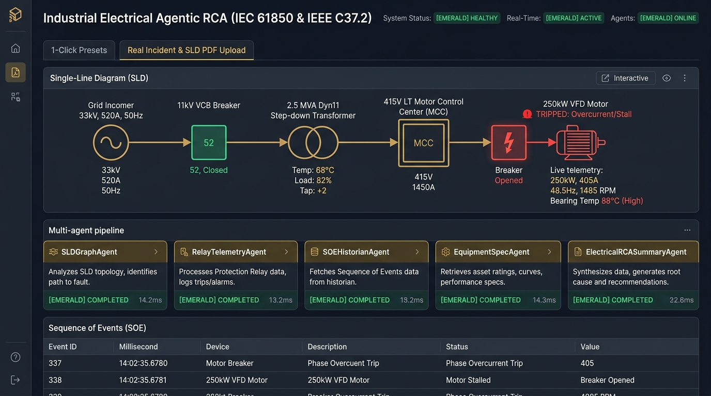
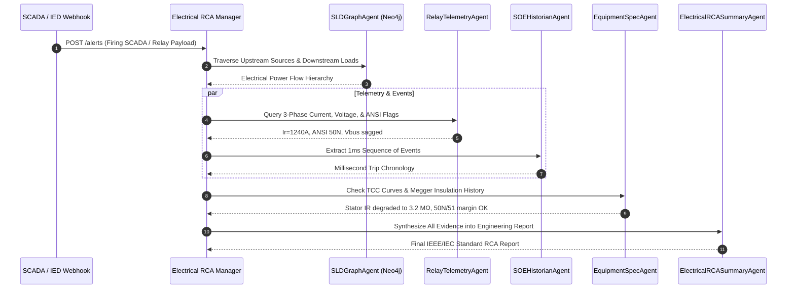

# ⚡ Industrial Electrical SLD Multi-Agent Root Cause Analysis (RCA) Engine

[](https://fastapi.tiangolo.com)
[](https://react.dev)
[](https://standards.ieee.org/)
[](https://opensource.org/licenses/MIT)



An autonomous multi-agent engineering intelligence system designed to ingest substation Single-Line Diagram (SLD) drawings, analyze SCADA/relay trip logs, trace physical power distribution topologies, and synthesize IEEE C37.2 & IEC 60255 compliant post-trip RCA reports.

---

## 🎯 Key Capabilities

- **✍️ Real-World Incident Ingestion:** Accepts raw control room handover logs, SCADA alarm transcripts, and relay codes, with 4 built-in realistic presets (Stator Earth Fault `50N`, Transformer Winding Overheat `49T/63`, Utility Voltage Sag `27`, Busbar Flashover `50`).
- **📑 SLD PDF Parser (`pdf_sld_parser.py`):** Automatically extracts electrical apparatus hierarchies, voltage classes (33kV, 11kV, 415V), and ANSI protective device allocations directly from engineering vector PDFs.
- **🧠 Hybrid LLM / Offline Engineering Fallback:** Integrates Gemini 2.5 Flash / OpenAI for deep diagnostic reasoning, with a zero-dependency local rule engine that executes full selectivity audits and clearance timing analysis offline.
- **⏱️ 1ms Sequence of Events (SOE) Ordering:** Distinguishes primary initiating protective operations from secondary sympathetic trips using sub-cycle timestamps.
- **🛡️ Actionable CAPA:** Produces structured Lockout/Tagout (LOTO), insulation resistance (1,000V Megger/PI), and breaker contact resistance test protocols.

---

## 🏗️ Topology & Electrical Power Flow Architecture

$$\mathbf{Grid\ Incomer\ (33kV/11kV)} \longrightarrow \mathbf{11kV\ VCB} \longrightarrow \mathbf{Dyn11\ Transformer} \longrightarrow \mathbf{415V\ LT\ MCC} \longrightarrow \mathbf{VFD\ Motor\ (250kW)}$$

```mermaid
graph TD
    subgraph Power Distribution Hierarchy
        GI["Utility Grid Incomer (GRID-INC-01)<br>33kV / 11kV | 40 MVA Fault Level"]
        VCB["11kV Vacuum Circuit Breaker (VCB-11KV-01)<br>Rated 1250A / 25kA | Relay: ABB REF615"]
        TR["Step-Down Transformer (TR-11KV-415V-01)<br>2.5 MVA Dyn11, %Z=6.25% | Buchholz + WTI"]
        MCC["415V LT Motor Control Center (MCC-415V-01)<br>3200A Busbar, 50kA | Incomer ACB"]
        MTR["Boiler Feed Water Pump VFD Motor (MTR-VFD-01)<br>250 kW ABB ACS880 Drive + 410A Induction Motor"]
    end

    GI -->|11kV 3C x 300 mm² XLPE Al Cable| VCB
    VCB -->|11kV 3C x 185 mm² XLPE Cu Cable| TR
    TR -->|3200A 4-Pole Sandwich Busduct| MCC
    MCC -->|Drive Cable (Feeder FD-MTR-01)| MTR
```

---

## 🤖 Multi-Agent Orchestration Architecture

The system coordinates five specialized agents:



1. **`SLDGraphAgent`**: Queries the Single-Line Diagram power distribution graph for upstream feeds, downstream branches, rated capacities, and breaker statuses.
2. **`RelayTelemetryAgent`**: Retrieves Intelligent Electronic Device (IED) measurements ($I_R, I_Y, I_B$, line voltages, frequency, power factor, THD %, and ANSI trip codes: 50, 51, 50N, 87, 49, 27, 59, 63).
3. **`SOEHistorianAgent`**: Ingests high-resolution 1-millisecond Sequence of Events logs to establish exact chronological order and distinguish the primary initiating fault from consequential trips.
4. **`EquipmentSpecAgent`**: Correlates fault data against Time-Current Characteristic (TCC) coordination curves, cable $I^2t$ withstand limits, and maintenance logs (Megger insulation resistance, DGA oil tests).
5. **`ElectricalRCASummaryAgent`**: Synthesizes all findings into a structured IEEE/IEC-compliant Markdown RCA report.

---

## ⚡ Supported Protection Functions (ANSI Device Numbers)

- **`50 / 51`**: Instantaneous / Time-delay Phase Overcurrent
- **`50N / 51N`**: Instantaneous / Time-delay Earth Fault / Ground Overcurrent
- **`87T / 87M`**: Transformer / Motor Differential Protection
- **`49T / 49OT`**: Transformer Winding / Oil High Temperature (WTI / OTI)
- **`63`**: Buchholz Gas Accumulation & Surge Relay
- **`27 / 59`**: Under-voltage / Over-voltage Protection
- **`51LR`**: Motor Locked Rotor / Stall Protection
- **`38`**: Motor Bearing Temperature RTD Protection
- **`94 / 52`**: Breaker Tripping Auxiliary Relay & Circuit Breaker Mechanism

---

## 🚀 1-Click Quickstart

### Prerequisites
- Python 3.10+
- Node.js 18+ (for frontend dashboard)

### Option A: 1-Click Launch (Windows)
Double-click `start_app.bat` or run in PowerShell:
```powershell
.\start_app.ps1
```
This automatically boots the FastAPI backend (`http://localhost:8001`), compiles the Next.js UI (`http://localhost:3000`), and launches your default browser.

### Option B: Manual Terminal Launch

**1. Start Backend Engine:**
```powershell
python -m venv .venv
.\.venv\Scripts\activate
pip install -r requirements.txt
uvicorn agents.electrical_app:app --host 0.0.0.0 --port 8001 --reload
```

**2. Start Frontend Dashboard:**
```powershell
cd frontend
npm install
npm run dev
```
Open your browser to `http://localhost:3000`.

---

## 🧪 Automated Headless Test Suite

To verify the multi-agent reasoning chain and report synthesis in a terminal environment:
```powershell
python scripts/test_electrical_alert.py
```

---

## 👨‍💼 Engineering Architecture & Design

**Architected by Amaresh Das**  
*Senior Industrial Project, Electrical Infrastructure & AI Transformation Consultant*  
23+ years of experience in 33kV/11kV substation commissioning, protection relay configuration, and capital project controls.  
- 🌐 [ProEngineering](https://proengineering.in)
- 💼 [LinkedIn Profile](https://linkedin.com)

---

## 📜 License

MIT License. Copyright (c) 2026 **Amaresh Das**.
