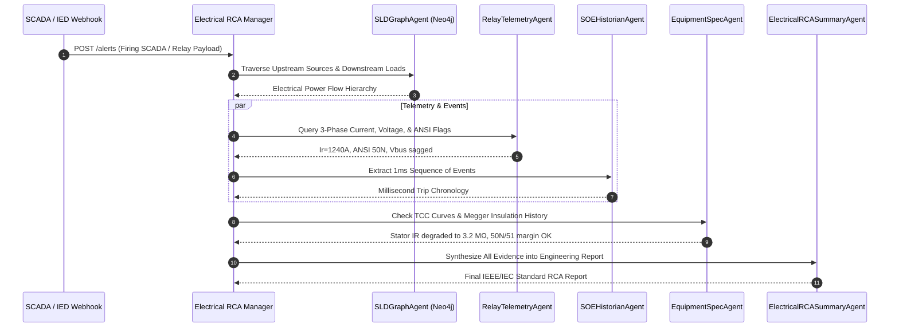

# Industrial Electrical Single-Line Diagram (SLD) Root Cause Analysis (RCA)

An autonomous multi-agent Root Cause Analysis platform for Industrial Electrical Power Distribution and Substation Automation systems.

Developed by **Amaresh Das**.

---

## 1. Executive Overview

This engine ingests real-time SCADA / DCS / Intelligent Electronic Device (IED) alert payloads, queries electrical Single-Line Diagram (SLD) power flow topologies, correlates sub-second Sequence of Events (SOE) logs, inspects protection relay settings (ANSI codes), and generates standardized **IEEE C37.2 / IEC 60255** Root Cause Analysis reports.

### Electrical Single-Line Diagram (SLD) Topology:

$$\mathbf{Grid\ Incomer\ (33kV/11kV)} \longrightarrow \mathbf{11kV\ VCB} \longrightarrow \mathbf{Step\text{-}down\ Transformer\ (11kV/415V)} \longrightarrow \mathbf{LT\ MCC\ (415V)} \longrightarrow \mathbf{VFD\ Motor\ (250kW)}$$

```mermaid
graph TD
    subgraph Power Distribution Hierarchy
        GI["Utility Grid Incomer (GRID-INC-01)<br>33kV / 11kV | 40 MVA Fault Level"]
        VCB["11kV Vacuum Circuit Breaker (VCB-11KV-01)<br>Rated 1250A / 25kA | Relay: ABB REF615"]
        TR["Step-Down Transformer (TR-11KV-415V-01)<br>2.5 MVA Dyn11, %Z=6.25% | Buchholz + WTI"]
        MCC["415V LT Motor Control Center (MCC-415V-01)<br>3200A Busbar, 50kA | Incomer ACB"]
        MTR["Boiler Feed Water Pump VFD Motor (MTR-VFD-01)<br>250 kW ABB ACS880 Drive + 410A Induction Motor"]
    end

    GI -->|11kV 3C x 300 mm² XLPE Al Cable| VCB
    VCB -->|11kV 3C x 185 mm² XLPE Cu Cable| TR
    TR -->|3200A 4-Pole Sandwich Busduct| MCC
    MCC -->|Drive Cable (Feeder FD-MTR-01)| MTR
```

---

## 2. Multi-Agent System Architecture

The pipeline coordinates five specialized agents:



1. **`SLDGraphAgent`**: Queries the Neo4j Single-Line Diagram power distribution graph for upstream feeds, downstream branches, rated capacities, and breaker statuses.
2. **`RelayTelemetryAgent`**: Retrieves Intelligent Electronic Device (IED) measurements ($I_R, I_Y, I_B$, line voltages, frequency, power factor, THD %, and ANSI trip codes: 50, 51, 50N, 87, 49, 27, 59, 63).
3. **`SOEHistorianAgent`**: Ingests high-resolution 1-millisecond Sequence of Events logs to establish exact chronological order and distinguish the primary initiating fault from consequential trips.
4. **`EquipmentSpecAgent`**: Correlates fault data against Time-Current Characteristic (TCC) coordination curves, cable $I^2t$ withstand limits, and maintenance logs (Megger insulation resistance, DGA oil tests).
5. **`ElectricalRCASummaryAgent`**: Synthesizes all findings into a structured IEEE/IEC-compliant Markdown RCA report.

---

## 3. Supported Protection Functions (ANSI Device Numbers)

- **`50 / 51`**: Instantaneous / Time-delay Phase Overcurrent
- **`50N / 51N`**: Instantaneous / Time-delay Earth Fault / Ground Overcurrent
- **`87T / 87M`**: Transformer / Motor Differential Protection
- **`49T / 49OT`**: Transformer Winding / Oil High Temperature (WTI / OTI)
- **`63`**: Buchholz Gas Accumulation & Surge Relay
- **`27 / 59`**: Under-voltage / Over-voltage
- **`51LR`**: Motor Locked Rotor / Stall Protection
- **`38`**: Motor Bearing Temperature RTD Protection

---

## 4. Quick Start: 1-Click Interactive App Launcher

You can launch the entire stack—both the Multi-Agent FastAPI backend (`:8001`) and the Next.js interactive SLD canvas (`:3000`) with automatic browser launch—in **one click**:

### Windows Command Prompt / Double-Click:
```cmd
start_app.bat
```
*(Or double-click `start_app.bat` in Windows File Explorer)*

### PowerShell:
```powershell
.\start_app.ps1
```

Both launchers will:
1. Detect and activate the Python virtual environment (`.venv`).
2. Start the FastAPI Multi-Agent backend server on `http://localhost:8001`.
3. Launch the Next.js dashboard on `http://localhost:3000`.
4. Open your default web browser directly to `http://localhost:3000`.

---

## 5. Manual Setup & Testing

### Step 1: Initialize Python Virtual Environment
```powershell
python -m venv .venv
.\.venv\Scripts\pip install -r agents/requirements.txt
```

### Step 2: Seed the SLD Topology
```powershell
.\.venv\Scripts\python scripts/seed_sld_neo4j.py
```
*(Populates Neo4j if active at `bolt://localhost:7687`, or generates local cache `scripts/sld_graph_cache.json` for offline simulation).*

### Step 3: Run the Multi-Agent CLI Simulation
```powershell
.\.venv\Scripts\python scripts/test_electrical_alert.py
```
This triggers an instantaneous Phase R earth fault alert (`50N`) on the `MTR-VFD-01` motor feeder, executes the full multi-agent analysis, and writes the resulting report to `scripts/sample_electrical_rca_report.md`.

### Step 4: Run the Backend API Separately
```powershell
.\.venv\Scripts\python -m uvicorn agents.electrical_app:app --host 0.0.0.0 --port 8001 --reload
```
- API Endpoint: `http://localhost:8001`
- Swagger Docs: `http://localhost:8001/docs`
- 1-Click Scenario Endpoint: `GET /api/scenarios`
- Synchronous Multi-Agent Analysis: `POST /api/analyze`
- Webhook: `POST /alerts`
- WebSocket Stream: `ws://localhost:8001/process/{websocket_id}`

### Step 5: Run the Frontend Separately
```powershell
cd frontend
npm install
npm run dev
```
Open `http://localhost:3000` to interact with the Single-Line Diagram and inspect live apparatus telemetry.

---

## 5. License

MIT License. Copyright (c) 2026 **Amaresh Das**.
